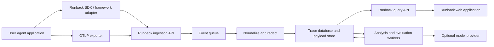
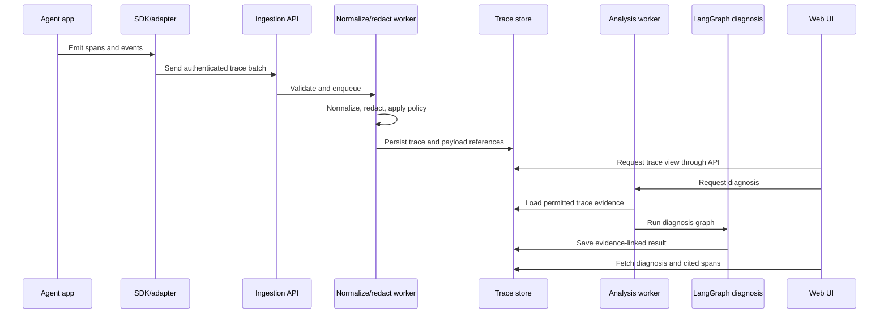
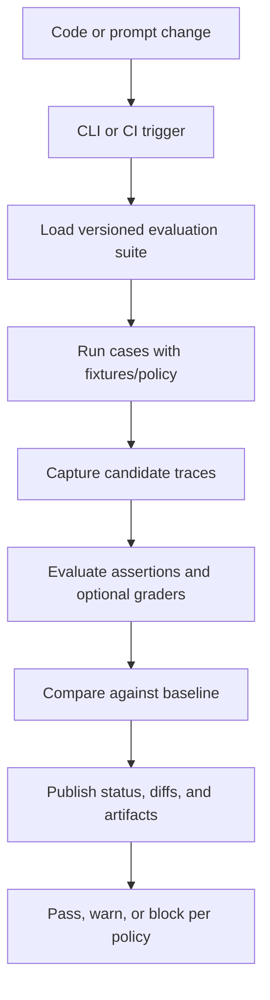

# Runback — Architecture and Flow

**Status:** Product vision  
**Version:** 1.0  
**Date:** 21 November 2026

## 1. Architecture goals

- Support a full hosted product and a local development mode.
- Keep ingestion independent from any single agent framework.
- Store normalized trace records while retaining a controlled raw representation for forward compatibility.
- Keep ingestion fast and decouple analysis, evaluation, and notifications.
- Make replay safe and explicit about what actually executes.
- Make AI diagnosis optional, provider-configurable, and grounded in trace evidence.
- Provide a realistic implementation path for the two-day build without narrowing the product requirements.

## 2. Framework decision

### Recommendation: LangGraph for Runback’s diagnosis workflow; OpenTelemetry plus adapters for product ingestion

Runback is an observability product, so the product should not require an agent framework to ingest or display traces. Use the OpenTelemetry trace model and OTLP as the framework-neutral base; add adapters that map framework-specific concepts into Runback’s canonical event model.

Use **LangGraph** for Runback’s own optional diagnosis workflow. Its explicit graph structure, state checkpoints, and recovery model suit a multi-step process that classifies a run, gathers evidence, forms hypotheses, proposes tests, and pauses for human review. Keep model calls behind a provider interface so users can choose local inference or a provider key. The graph itself should be useful in no-model mode for deterministic checks and evidence gathering.

| Option | Strength for Runback | Trade-off | Decision |
|---|---|---|---|
| LangGraph | Explicit stateful workflow, checkpointing, controlled branching and recovery. | Adds LangChain ecosystem concepts; graph state still needs a separate telemetry export path. | Use for optional diagnosis orchestration. |
| OpenAI Agents SDK | Built-in traces for model generations, tool calls, handoffs, guardrails, and custom events; supports custom trace processors. | Default trace flow is OpenAI-oriented; the docs warn spans may contain sensitive inputs/outputs. | Build and maintain an adapter; do not make it the product core. |
| CrewAI | Python-native agents, crews, and flows; useful for testing multi-agent team workflows. | Its high-level abstractions are unnecessary for Runback’s own deterministic diagnosis pipeline. | Add a framework adapter; do not use as the core runtime. |
| OpenTelemetry | Vendor-neutral trace/span model and exporter ecosystem. | Agent-specific semantics need conventions or adapter mapping. | Canonical ingestion foundation. |

**Practical two-day choice:** implement the product’s trace model and a deterministic sample run first. Do not make product behavior depend on a live LLM. Add the LangGraph diagnosis graph and framework adapters as the next implementation work, using recorded fixtures to demonstrate them without a paid API key.

## 3. System context

The system context is logical; a two-day implementation may run the API, worker, and database in one local process while preserving these module boundaries.

## 4. Product components

### Web application

TypeScript frontend with workspace/project navigation, run explorer, trace timeline, span inspector, comparison, evaluation suites, integration setup, and policy controls. It consumes the versioned API and never reads the database directly.

### Python API

Python web service responsible for authentication, project configuration, ingest endpoints, trace queries, evaluation management, replay requests, and access policy enforcement. Keep ingestion routes separately rate-limited and optimized for batch payloads.

### SDK and adapters

- Python SDK provides run/span context, capture configuration, redaction hooks, and OTLP or Runback transport.
- Framework adapters translate LangGraph, OpenAI Agents SDK, and CrewAI runs into canonical Runback events.
- TypeScript SDK and additional framework adapters can follow the same public schema.
- Adapter versions and source framework versions are recorded on each trace.

### Ingestion and normalization

Validate auth and size limits → parse supported schema → apply tenant capture policy → redact configured values → normalize identifiers and timestamps → persist idempotently → enqueue post-ingestion work. Invalid events return structured errors with a request/correlation ID.

### Storage

- Relational database for tenants, projects, environments, tokens, traces, spans, cases, suites, evaluation runs, comments, and audit records.
- JSONB for variable attributes and bounded structured payloads.
- Object storage for large payloads and export artifacts, encrypted and governed by the same retention policy.
- Search index only when query volume and filtering needs justify it; begin with database indexes and add a dedicated index as scale requires.

### Background workers

Separate queues/jobs for trace summarization, diagnosis, evaluation execution, exports, notifications, and retention cleanup. Work items carry tenant and trace identifiers, are idempotent, and expose status and retry history.

### Diagnosis service

LangGraph workflow with stages: classify run → gather trace evidence → detect deterministic anomalies → form evidence-linked hypotheses → suggest tests/cases → confidence and policy check → persist a reviewable result. Every hypothesis stores referenced span IDs, prompt/model/provider version when applicable, and analysis version. No graph node executes user tools.

### Replay service

Replay modes are separate code paths with explicit policies:

1. Recorded playback renders stored steps without executing code.
2. Mocked replay executes selected application logic against recorded model/tool fixtures.
3. Sandboxed replay uses isolated workers and allowlisted tools.
4. Live replay invokes configured providers and external tools only after explicit confirmation and policy checks.

Every branch links to its source trace, records mode and fixture provenance, and is treated as a new run.

## 5. Canonical data model

### Trace

`trace_id`, `tenant_id`, `project_id`, `environment_id`, `source_framework`, `source_version`, `agent_name`, `agent_version`, `started_at`, `ended_at`, `status`, `attributes`, `schema_version`, `ingest_idempotency_key`, `parent_trace_id`, `replay_mode`.

### Span

`span_id`, `trace_id`, `parent_span_id`, `name`, `kind`, `start_time`, `end_time`, `status`, `status_message`, `attributes`, `events`, `links`, `input_payload_ref`, `output_payload_ref`, `redaction_summary`, `source_span_id`.

### Evaluation case and suite

Case fields: `case_id`, `project_id`, `name`, `source_trace_id`, `input_fixture`, `tool_fixtures`, `assertions`, `tags`, `version`, `created_by`, `review_state`. Suite fields: `suite_id`, `cases`, `baseline`, `gate_policy`, `owner`, `version`.

### Analysis result

`analysis_id`, `trace_id`, `analysis_version`, `provider`, `model`, `status`, `summary`, `hypotheses`, `evidence_span_ids`, `confidence_label`, `created_at`, `policy_snapshot`.

### Evaluation result

`evaluation_run_id`, `suite_id`, `case_id`, `candidate_version`, `result`, `assertion_results`, `score`, `baseline_delta`, `artifacts`, `created_at`.

Payloads have configurable size limits and may be stored separately from metadata. Deleting a trace must remove payload objects and derived analysis artifacts according to tenant retention policy.

## 6. API surface

Version all public routes, for example under `/api/v1`.

| Route | Purpose |
|---|---|
| `POST /api/v1/ingest/traces` | Ingest a Runback JSON batch. |
| `POST /api/v1/otlp/v1/traces` | OTLP trace ingestion endpoint. |
| `GET /api/v1/projects/{project_id}/traces` | Search and paginate traces. |
| `GET /api/v1/traces/{trace_id}` | Fetch normalized trace and spans. |
| `GET /api/v1/traces/{trace_id}/compare/{other_trace_id}` | Return structured differences. |
| `POST /api/v1/traces/{trace_id}/analyses` | Queue optional diagnosis. |
| `POST /api/v1/cases` | Create or version an evaluation case. |
| `POST /api/v1/suites/{suite_id}/runs` | Start an evaluation run. |
| `GET /api/v1/evaluation-runs/{run_id}` | Read evaluation status/results. |
| `POST /api/v1/replays` | Request replay with an explicit mode and policy context. |
| `GET /api/v1/replays/{replay_id}` | Read replay status and linked child trace. |

Ingestion endpoints use scoped project tokens; user-facing endpoints use session/OIDC authentication in hosted deployments. All tenant-scoped reads and writes enforce tenant identity at the service boundary.

## 7. Primary data flow: capture to diagnosis

## 8. Primary data flow: evaluation and CI

CI execution should use scoped credentials, immutable suite versions, and explicit policies for external calls. A test result must identify the code/agent version, suite version, fixtures, and evaluator version.

## 9. Security, privacy, and reliability

- Authenticate SDK ingestion with project-scoped, revocable tokens; rotate and scope credentials.
- Enforce tenant isolation in every query and background job.
- Redact before persistence and before any external model call; allow field-level capture controls.
- Never store provider secrets with traces. Store encrypted credentials in a dedicated secret store in hosted environments.
- Keep untrusted trace content out of system prompts and treat it as data, not instructions.
- Set ingestion limits, request timeouts, payload size limits, and per-tenant quotas.
- Use idempotency keys and unique span constraints to protect retry semantics.
- Use database migrations and schema version compatibility checks.
- Record audit events for export, access-policy changes, token management, and deletion.
- Apply retention/deletion to primary rows, object storage, derived summaries, and exports.

## 10. Deployment topology

### Local development

Frontend dev server + Python API + SQLite or local Postgres + local filesystem payload store + synchronous/in-process worker. The local profile enables quick demo data and no API key requirement.

### Hosted product

Web frontend behind CDN → API service → PostgreSQL → object storage; durable queue → worker pool; secret manager; OIDC identity; metrics/logs/traces; backup and retention jobs. Keep worker scale independent from API scale.

### Self-hosted product

Containerized services with customer-managed database/object storage/secrets and documented environment configuration. Support outbound-disabled mode for teams that require local model inference and local telemetry storage.

## 11. Full-product delivery sequence

The two-day build is the first implementation window; it does not redefine the product scope. Build in vertical slices that maintain the architecture:

1. **Product spine:** app shell, Python API, canonical trace schema, ingest/import, persistence, trace explorer, sample trace.
2. **Debug workflow:** trace hierarchy, span inspection, run comparison, annotations, case creation, deterministic assertions.
3. **Agent integrations:** OpenTelemetry/OTLP, LangGraph, OpenAI Agents SDK, CrewAI adapters and SDK documentation.
4. **Replay and evaluations:** fixture-based replay, safe sandbox/live policies, suite runner, CLI and CI outputs.
5. **AI diagnosis:** LangGraph workflow, evidence citations, local/BYOK provider interface, review and feedback capture.
6. **Team and production controls:** authentication, workspaces, RBAC, audit, retention, quotas, notifications, managed/self-hosted deployment.

At the end of the initial two-day window, the product should have a coherent end-to-end trace workflow and a polished UI spine. The remaining capabilities are planned product work, not omitted product requirements.

## 12. Research and technical references

- [OpenTelemetry traces and spans](https://opentelemetry.io/docs/concepts/signals/traces/) — vendor-neutral hierarchy, context propagation, span status, attributes, and exporter model.
- [OpenTelemetry trace semantic conventions](https://opentelemetry.io/docs/specs/semconv/general/trace/) — conventions support consistent interpretation across languages and systems.
- [OpenAI Agents SDK tracing](https://openai.github.io/openai-agents-python/tracing/) — built-in agent trace concepts and custom trace processors; sensitive input/output capture needs policy controls.
- [LangGraph persistence](https://docs.langchain.com/oss/python/langgraph/persistence) — graph checkpointing for recovery, time travel, and fault tolerance.
- [CrewAI documentation](https://docs.crewai.com/) — Python framework model for agents, crews, and flows.

